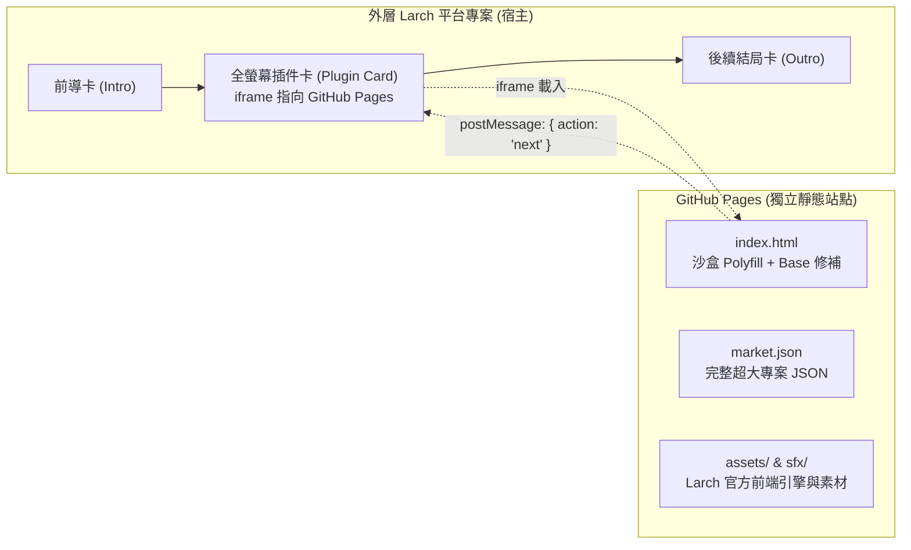

# Larch 大專案 GitHub Pages 靜態部署與全螢幕內嵌 Skill

當 Larch 專案規模過大（節點超過數百個、語音檔幾百 MB、高清 CG 素材過多）導致無法直接推上 Larch 平台或遇到檔案上限時，使用本方案：
**將遊戲本體做成免伺服器、純靜態的 GitHub Pages 站點，再以外層 Larch 專案的「全螢幕插件卡」無縫內嵌回來。**

玩家在 Larch 線上平台遊玩時，外觀完全是原生 Larch 體驗，但內容實質託管於 GitHub Pages，容量無上限。

---

## 核心架構



### 內嵌站點必備的 4 大相容補丁（本 repo 已自動化處理）
1. **沙盒 Storage Polyfill**：Larch 插件卡的 iframe 預設沒有 `allow-same-origin`，直接存取 `localStorage` / `sessionStorage` 會拋出 `SecurityError`。本方案在 `<head>` 最前端注入純記憶體字典的 Storage polyfill。
2. **Vite 相對路徑基底 (`__LARCH_BASE__`)**：Larch 原生 Vite 打包將 chunk 路徑寫死為絕對路徑 `return "/" + l`，在 GitHub Pages 子路徑（如 `username.github.io/my-game/`）會 404。本方案修補為 `(window.__LARCH_BASE__ || "./") + l`。
3. **SPA 路由直通**：Larch 原生路由在非根路徑會顯示行銷頁。本方案修補 `Re()` 路由判斷，使其直接啟動本地 `/play/market/local` 遊戲實例。
4. **選擇卡型別強制轉換**：相容選擇卡字串陣列與物件格式，防止 `Preview-*.js` 拋出 `(e || "").replace is not a function`。

---

## 其他 AI 如何使用本 Repo 建立新專案

當你要為使用者的另一個大型 Larch 專案建立 GitHub Pages 部署時，請遵循以下步驟：

### 步驟 1：建立新的 GitHub 儲存庫
複製本 repo 的結構或新建 repo，目錄結構如下：
```text
my-larch-game/
├── .github/workflows/
│   └── update-player.yml      # GitHub Actions 定時自動追蹤最新官方引擎
├── scripts/
│   ├── lp/rewrite.py          # 專案格式轉譯器
│   ├── sync.py                # 官方引擎下載同步器
│   ├── export_pages.py        # 靜態化與補丁打包器
│   └── build.py               # 統一建置 CLI
├── src/
│   ├── project.json           # 你的超大專案 JSON
│   └── assets/                # 本地素材 (圖、音效等)
└── SKILL.md
```

### 步驟 2：放入目標專案檔
1. 將目標專案的完整 JSON 存為 `src/project.json`。
2. 將所有本地圖片、音效放置於 `src/assets/`（卡片內的參照路徑寫相對路徑即可，例如 `bg-forest.svg`）。
3. 若素材過多，也可配合 jsDelivr CDN 託管（參照下方素材 CDN 規範）。

### 步驟 3：執行本地建置與驗收
```bash
# 抓取官方最新前端引擎並編譯打包
python3 scripts/build.py --update

# 本機預覽測試
python3 -m http.server 8080
# 瀏覽器打開 http://localhost:8080 驗收遊玩
```

### 步驟 4：推送到 GitHub 並開啟 Pages
```bash
git add -A
git commit -m "feat: initial larch static game deploy"
git push origin main

# 啟用 GitHub Pages (Branch: main, Path: /)
gh api repos/<owner>/<repo>/pages -X POST -f "source[branch]=main" -f "source[path]=/"
```
取得 Pages 網址：`https://<owner>.github.io/<repo>/`

### 步驟 5：在外層 Larch 專案建立全螢幕插件卡
在宿主 Larch 專案（透過 `larch-story-studio` MCP 或線上編輯器）加入插件卡節點：
```json
{
  "id": "card-embed-game",
  "type": "story",
  "data": {
    "type": "plugin",
    "pluginId": "plugin-iframe",
    "presentation": "fullscreen",
    "config": {
      "url": "https://<owner>.github.io/<repo>/"
    }
  }
}
```

### 步驟 6：雙向通訊協議（結束內嵌並返回主線）
在 GitHub Pages 遊戲的最後一張卡片或自訂按鈕中，呼叫 postMessage：
```javascript
// 通知外層 Larch 跳至下一張卡片
window.parent.postMessage({
  type: 'larch:action',
  action: 'next'
}, '*');
```

外層 Larch 收到訊號後，會順著邊（Edge）自動推進到後續卡片。

---

## GitHub Actions 自動維護機制

本 repo 內建 `.github/workflows/update-player.yml`：
- **定時檢查**：每週一自動向 `https://larch.ink` 查詢前端版本 hash。
- **自動修補**：當 Larch 官方發佈新版播放器時，Action 會自動下載最新 bundle、重新套用 4 大相容補丁、重新打包並 commit push。
- **零人工維護**：內嵌的 GitHub Pages 始終保有最新版 Larch 播放器的效能與特性。

---

## 常見問題與除錯 (Troubleshooting)

1. **GitHub Pages 出現 404**：
   - 確保根目錄有 `.nojekyll`，防止 Jekyll 阻擋 `_` 開頭的檔案。
   - 確保 Vite preload helper 已修補 `window.__LARCH_BASE__ = './'`。
2. **iframe 拋出 SecurityError**：
   - 確認 `index.html` 的 `<head>` 第一行已正確注入 Storage Polyfill。
3. **選擇卡停住或抱錯**：
   - 確認 `Preview-*.js` 已注入 `da` 選擇項文字強制轉字串補丁。
4. **專案缺少欄位造成白畫面**：
   - 使用 `scripts/lp/rewrite.py` 中的 `fill_defaults()` 自動補齊 `settings`、`characters`、`media`、`variables` 與節點 `position`。
